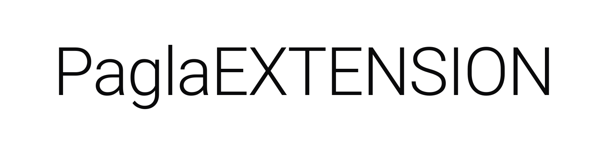

<p align="center">
  <a href="https://github.com/paglaai/PaglaEXTENSION">
    
  </a>
</p>

<p align="center">
  <strong>Ambient Browser Companion, Contextual AI Assistant, and Local-First Workspace Sidecar.</strong>
</p>

<p align="center">
  <a href="https://www.paglaai.space/products/"></a>
  <a href="https://github.com/paglaai/PaglaEXTENSION/actions"></a>
  <a href="https://github.com/paglaai/PaglaEXTENSION/releases"></a>
  <a href="https://github.com/paglaai/PaglaDESIGN"></a>
  <a href="./LICENSE"></a>
</p>

---

## Overview

**PaglaEXTENSION** is the ambient browser companion for the PaglaAI ecosystem. Built on **Chrome Manifest V3**, it integrates sovereign AI reasoning directly into active web workflows—inspecting page content, summarizing technical documentation, drafting responses, and interfacing securely with your local Apple Silicon inference node ([PaglaMLX](https://github.com/paglaai/PaglaMLX)).

All page data stays local. PaglaEXTENSION connects directly to your sovereign machine without passing through third-party proxies.

```
                 ┌────────────────────────────────────────┐
                 │       Active Web Browser Tab           │
                 │      DOM Tree • Page Content           │
                 └───────────────────┬────────────────────┘
                                     │
         ┌───────────────────────────┴───────────────────────────┐
         ▼                                                       ▼
┌──────────────────────────────┐              ┌──────────────────────────────┐
│    Content Script Engine     │              │    Background Service Worker │
│ Contextual Semantic Analysis │              │ Localhost Gateway Connector  │
└──────────────┬───────────────┘              └──────────────────────────────┘
               │
               ▼
┌────────────────────────────────────────────────────────────────────────────┐
│                    Local Inference Node (PaglaMLX / ROUTER)                │
│                         http://127.0.0.1:8080/v1                           │
└────────────────────────────────────────────────────────────────────────────┘
```

## Core Capabilities

- **Contextual DOM Extraction**: Reads active tab semantics to generate high-density summaries, technical breakdowns, and code explanations.
- **Localhost-First Execution**: Routes queries directly to `http://localhost:8080` for zero-latency, private inference.
- **Ambient Floating Assistant**: Compact, non-intrusive UI overlay engineered strictly according to PaglaDESIGN tokens.
- **Zero Third-Party Telemetry**: Never transmits cookies, session tokens, or browsing history to external cloud endpoints.

## Quick Start

Load the extension into Chrome, Brave, or any Chromium browser:

```bash
# Install dependencies
npm install

# Build extension bundle
npm run build
```

1. Open Chrome and navigate to `chrome://extensions/`.
2. Enable **Developer mode** in the top right.
3. Click **Load unpacked** and select the `dist/` directory of this repository.

## Architecture & Tech Stack

| Component | Specification |
| :--- | :--- |
| **Extension Standard** | Google Chrome Manifest V3 |
| **Runtime Core** | TypeScript, React, Vite |
| **Backend Endpoint** | Local PaglaROUTER / PaglaMLX at `http://127.0.0.1:8080` |
| **Styling** | PaglaDESIGN tokens, dark glass aesthetic |

## DesignDNA & Ecosystem Authority

The extension popup and sidepanel use the official [PaglaDESIGN](https://github.com/paglaai/PaglaDESIGN) component styles:
- **Background**: Obsidian Glass `rgba(10, 10, 11, 0.95)`
- **Text**: Pure White `#FFFFFF` with Pagla Sans typography
- **Accent**: Semantic Cobalt `#6B7EFF`

## Security & Fail-Closed Policy

PaglaEXTENSION enforces a strict Content Security Policy. It is forbidden from fetching external unverified scripts or transmitting user session credentials.

${ecosystemDirectory}

${emailSection}

## License

PaglaEXTENSION is open-source software licensed under the **[MIT License](./LICENSE)**.

---

<p align="center">
  <sub>© 2026 AYNAGHOR. PaglaEXTENSION is part of the PaglaAI ecosystem. Every surface inherits from here.</sub>
</p>
